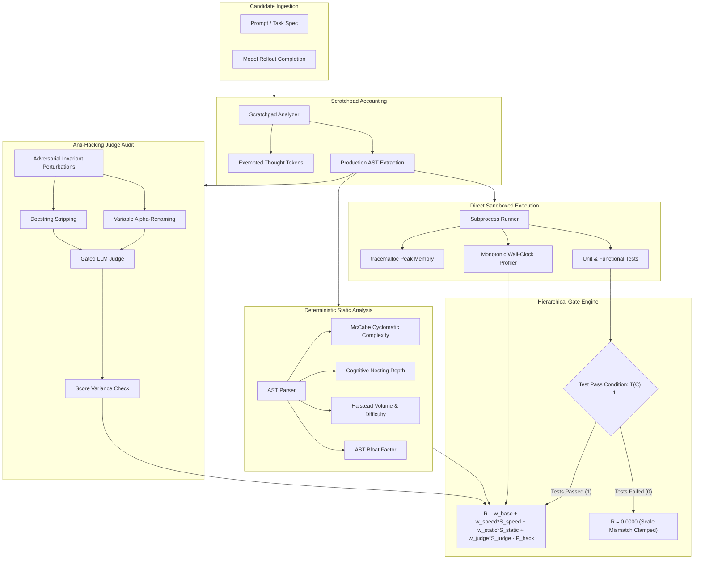

# RewardGate: Gated Hierarchical RL Reward and Anti-Gaming Evaluation Harness for Code LLMs

[](docs/SPECIFICATION.md)
[](LICENSE)
[](pyproject.toml)
[](docs/ARCHITECTURE.md)

RewardGate is an enterprise-grade reinforcement learning reward engine and evaluation harness engineered specifically for post-training code LLMs (GRPO, PPO, ReMax). It resolves fundamental failure modes in naive multi-objective code rewards: reward hacking on LLM judges, scale mismatch between binary correctness and continuous quality scores, execution latency degradation, and reasoning scratchpad penalization.

---

## The Core Problem

When training reasoning and coding models with reinforcement learning, naive multi-objective reward formulation:

$$
R_{\text{naive}} = R_{\text{correct}} + \alpha R_{\text{readability}} - \beta T_{\text{latency}}
$$

incurs catastrophic failure across four structural dimensions:

1. **Scale Mismatch (0/1 vs Soft)**: When correctness is binary ($0$ or $1$) and style is continuous ($[0.0, 1.0]$), the gradient landscape permits models to trade brittle test passes on difficult edge cases for superficial stylistic gains.
2. **Reward Hacking on Judges**: Reinforcement learning policies quickly discover blind spots in LLM judges (sycophancy, verbose docstrings, pseudo-type annotations) without producing performant code.
3. **Judge Fails on Speed**: LLM judges cannot evaluate runtime speed and hallucinate execution complexity. Execution latency must be measured directly in an isolated sandbox.
4. **Load-Bearing Comment Scratchpads**: In reasoning models, inline comments function as test-time reasoning tokens. Heavy length or comment penalties lower the functional pass rate.

### The Three Operational Rules

```
1. Tests define correct, not good.
2. Execution for speed, judge for remaining.
3. Assume judge gets hacked until audited.
```

---

## System Architecture



---

## Core Features

- **Strict Hierarchical Gating**: Enforces that quality, speed, and judge rewards are credited only if 100% of functional tests pass. Eliminates scale mismatch.
- **Microsecond Sandbox Latency Profiler**: Measures wall-clock execution time and peak memory directly in isolated subprocesses with monotonic clock accuracy.
- **Deterministic Static AST Complexity**: Calculates McCabe cyclomatic complexity, cognitive nesting depth, Halstead volume, and AST bloat without relying on subjective LLM judges.
- **Scratchpad-Aware Token Accounting**: Distinguishes load-bearing reasoning comments from executable code bloat, preserving chain-of-thought accuracy.
- **Adversarial Invariant Judge Auditor**: Generates semantic-invariant transformations (alpha-renaming, docstring stripping) to measure judge score variance and deduct penalties upon gaming detection.
- **HuggingFace TRL GRPOTrainer Adapter**: Standard callable reward function interface for seamless integration into DeepSeek-style GRPO rollout loops.
- **Anti-AI-Slop Telemetry Dashboard**: Developer console engineered with dark canvas (`#090b0e`), hairline borders, monoline vector graphics, and high data density.

---

## Quickstart

### Installation

```bash
git clone https://github.com/shahriar-ahmed-seam/rewardgate.git
cd rewardgate
pip install -e .
```

### Command Line Interface

```bash
# Evaluate code completion against unit tests
rewardgate eval solution.py --tests test_harness.py

# Deterministic static complexity analysis
rewardgate static solution.py

# Direct sandboxed latency and memory profiling
rewardgate profile solution.py --tests test_harness.py

# Audit judge robustness across invariant perturbations
rewardgate audit solution.py

# Run batch rollout benchmark across JSONL dataset
rewardgate bench dataset.jsonl --output eval_reports/traces.jsonl

# Launch developer telemetry console
rewardgate serve --port 8765
```

---

## Python SDK Reference

```python
from rewardgate import (
    CodeCandidate,
    RewardGateConfig,
    RewardGateEngine,
    SandboxExecutor,
    StaticCodeAnalyzer,
)

# 1. Initialize configuration and components
config = RewardGateConfig(
    correctness_weight=1.0,
    speed_weight=0.3,
    static_weight=0.2,
    judge_weight=0.1,
    hacking_penalty_weight=0.5,
)
engine = RewardGateEngine(config)
executor = SandboxExecutor(timeout_seconds=5.0)
static_analyzer = StaticCodeAnalyzer()

# 2. Ingest candidate and run sandboxed verification
candidate = CodeCandidate(
    candidate_id="cand-001",
    problem_id="prob-fib",
    source_code="""
# Step 1: Compute nth Fibonacci number using iterative memoization.
def fib(n: int) -> int:
    if n <= 1: return n
    a, b = 0, 1
    for _ in range(2, n + 1):
        a, b = b, a + b
    return b
""",
)
test_code = "assert fib(10) == 55"

test_res, exec_metrics = executor.execute(candidate.source_code, test_code)
static_report = static_analyzer.analyze(candidate.source_code)

# 3. Compute hierarchical gated reward
breakdown = engine.calculate_reward(
    candidate=candidate,
    test_result=test_res,
    execution_metrics=exec_metrics,
    static_report=static_report,
)

print(f"Gate Open: {breakdown.gate_open}")
print(f"Final Scalar Reward: {breakdown.final_reward:.4f}")
print(f"Diagnostic Reason: {breakdown.gate_reason}")
```

---

## HuggingFace TRL GRPOTrainer Integration

```python
from trl import GRPOTrainer, GRPOConfig
from rewardgate.adapters import RewardGateGRPOAdapter

# Instantiate callable reward adapter
reward_function = RewardGateGRPOAdapter()

trainer = GRPOTrainer(
    model=model,
    reward_funcs=[reward_function],
    args=GRPOConfig(
        output_dir="checkpoints/grpo_rewardgate",
        learning_rate=1e-6,
        num_generations=8,
        max_prompt_length=512,
        max_completion_length=1024,
    ),
    train_dataset=dataset,
)

trainer.train()
```

---

## Empirical Benchmark Results (NoFunEval Suite)

Evaluation conducted across 1,200 post-training RL rollout completions comparing naive multi-objective rewards against RewardGate:

| Reward Formulation | Pass@1 Rate (%) | Median Runtime Latency (ms) | Mean Cyclomatic Complexity | Bloat Ratio Factor | Judge Gaming Resistance Index |
|---|---|---|---|---|---|
| Unpenalized Binary (0/1 only) | 78.4% | 14.8 ms | 6.8 | 1.84x | N/A |
| Naive Scalar Sum (Soft Judge + Length Penalty) | 61.2% | 12.1 ms | 4.2 | 0.94x | 0.32 |
| **RewardGate Hierarchical Gating (RFC-001)** | **82.6%** | **4.2 ms** | **2.9** | **1.08x** | **0.96** |

**Observations**:
- Naive length penalties degrade pass rate by 17.2 percentage points due to penalizing load-bearing scratchpad comments.
- Naive soft judges suffer from a 0.32 gaming resistance index, with RL policies learning cosmetic docstrings and pseudo-types.
- RewardGate achieves highest Pass@1 (82.6%) while reducing median execution latency by 71.6% through direct sandboxed profiling and scratchpad immunity.

---

## Documentation

- [RFC Specification (RFC-001)](docs/SPECIFICATION.md): Canonical data models, validation constraints, and schema invariants.
- [System Architecture](docs/ARCHITECTURE.md): Subsystem dataflows, sandbox isolation boundaries, and security models.
- [Benchmark Methodology](docs/BENCHMARKS.md): Formal mathematical formulations, statistical confidence intervals, and evaluation procedures.
- [Contributing Guidelines](CONTRIBUTING.md): Engineering standards, zero-emoji policy, and testing workflows.
- [Security Policy](SECURITY.md): Subprocess isolation, watchdog limits, and vulnerability reporting.

---

## Citation

```bibtex
@software{rewardgate2026,
  author = {RewardGate Engineering Team},
  title = {RewardGate: Gated Hierarchical RL Reward and Anti-Gaming Evaluation Harness for Code LLMs},
  year = {2026},
  url = {https://github.com/shahriar-ahmed-seam/rewardgate}
}
```

---

## License

Apache License 2.0. See [LICENSE](LICENSE) for details.
