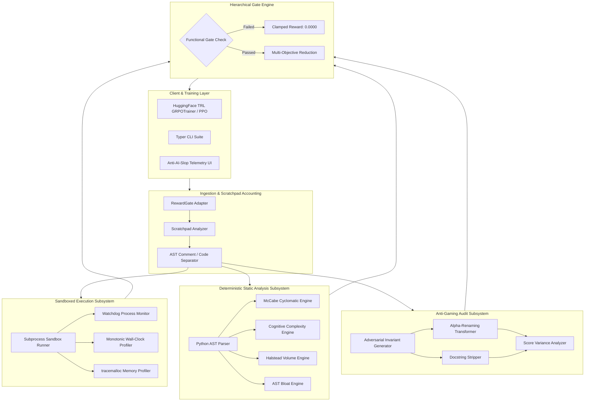

# RewardGate System Architecture and Operational Blueprint

## 1. Executive Architectural Overview

RewardGate provides an end-to-end evaluation harness and post-training reinforcement learning reward engine for code-generating large language models. The architecture isolates functional verification from non-functional quality metrics and enforces hierarchical gating to guarantee mathematical optimization stability.

The core design centers on three operational principles:
1. **Tests define correct, not good**: Functional correctness is non-negotiable. Quality rewards cannot compensate for failed assertions.
2. **Execution for speed, judge for remaining**: Execution latency is measured directly in isolated sandboxes using high-resolution monotonic clocks. LLM judges are never trusted for performance metrics.
3. **Assume judge gets hacked until audited**: Soft LLM judges are audited using semantic-invariant adversarial perturbations. If cosmetic sensitivity or prompt injection is detected, penalties are deducted.

---

## 2. Subsystem Dataflow and Component Boundaries

---

## 3. Subsystem Breakdown and Specifications

### 3.1 Scratchpad and Reasoning Token Accounting

Chain-of-thought code generation models (e.g., DeepSeek-R1, OpenAI o1/o3) rely on inline comments and multi-step thoughts as reasoning scratchpads. Standard length penalties penalize these thinking tokens, causing a steep decline in Pass@1.

The `ScratchpadAnalyzer` decomposes completions into:
- **Reasoning Scratchpad Tokens**: Inline comments containing algorithmic justifications, invariants, and step-by-step logic.
- **Production AST Code**: Pure executable statements.

When `config.scratchpad_penalty_exempt=True`, reasoning comments are immune to bloat penalties, allowing the policy to think thoroughly without optimization friction.

### 3.2 Sandboxed Execution Profiler

To prevent LLM judges from hallucinating code execution speed, the `SandboxExecutor` executes completions in dedicated subprocesses:
- **Isolation Boundary**: Each execution runs in an isolated Python interpreter with strict memory and time quotas.
- **Monotonic High-Resolution Timing**: Measures elapsed wall-clock time using `time.perf_counter_ns()` with microsecond accuracy.
- **Memory Profiling**: Tracks peak memory usage via `tracemalloc` to detect memory leaks and excessive allocations.
- **Watchdog Timeout**: Kills runaway infinite loops via process termination.

### 3.3 Deterministic Static Analysis Subsystem

Subjective LLM judges are prone to stylistic bias. The `StaticCodeAnalyzer` bypasses external judges by inspecting the concrete Python AST directly:
- **McCabe Cyclomatic Complexity**: Measures independent execution paths ($1 + \text{branches}$).
- **Cognitive Complexity**: Measures nesting depth to capture mental maintenance burden.
- **Halstead Program Volume**: Quantifies distinct and total operators/operands.
- **AST Bloat Factor**: Compares syntax tree size against baseline expected nodes for the problem.

### 3.4 Anti-Gaming Judge Auditor

Rule 3 mandates that LLM judges be treated as untrusted until audited. The `JudgeAuditor` applies semantic-invariant perturbations to code candidates:
1. **Alpha-Renaming**: Replaces local variable names with synthetic identifiers (`v_0`, `v_1`) while preserving external functions and built-in interfaces.
2. **Docstring Stripping**: Removes verbose commentary and docstrings that induce cosmetic judge bias.
3. **Variance Threshold**: Computes score variance across variants:

$$
\sigma^2 = \frac{1}{K} \sum_{i=1}^K (s_i - \bar{s})^2
$$

If $\sigma^2 > \text{threshold}$, reward gaming is confirmed and an anti-hacking penalty is applied.

---

## 4. Failure Mode Mitigations Matrix

| Failure Mode | Root Cause | Systemic Mitigation in RewardGate |
|---|---|---|
| **Scale Mismatch** | Unit test pass is 0/1; readability is soft [0, 1]. Model sacrifices correctness for style. | **Hierarchical Gating**: If tests fail, all quality rewards are strictly clamped to 0.0. |
| **Judge Latency Hallucination** | LLMs cannot predict runtime speed or algorithmic performance. | **Direct Sandboxed Profiling**: Real execution wall-clock measurement normalized against baseline. |
| **Judge Reward Hacking** | RL policy exploits cosmetic judge blind spots (polite docstrings, formatting). | **Adversarial Invariant Perturbations**: Invariance checking across alpha-renaming and docstring stripping. |
| **Scratchpad Degradation** | Penalizing token length strips models of reasoning tokens, lowering pass rate. | **Scratchpad-Aware Separation**: Reasoning comments are separated from AST bloat and exempted from penalties. |
| **Sandbox Hang / DoS** | Malicious or buggy infinite loops during training rollouts. | **Watchdog Process Supervisor**: Hard subprocess timeout and memory reclamation. |

---

## 5. Security Model and Operational Hardening

- Subprocess execution occurs with isolated environment variables.
- Temporary script files are generated with unique paths and removed in `finally` blocks.
- Resource limits prevent memory exhaustion attacks on rollout worker nodes.
